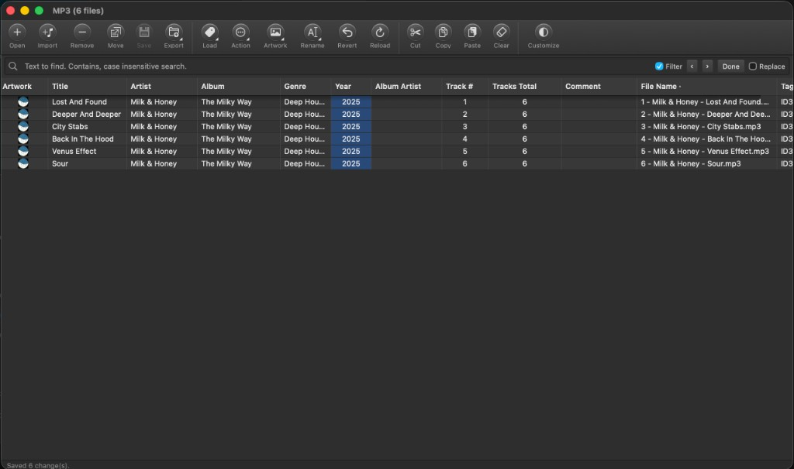

#  Tag Editor

&nbsp;

Desktop batch music tag editor. Open a folder, edit tags in a spreadsheet grid, save, and rename from a pattern.

Built with **Tauri 2**, **Vue 3**, and [lofty](https://github.com/Serial-ATA/lofty-rs) (MP3, FLAC, M4A, WAV, AIFF, OGG, Opus, and more).



## Run (dev)

```bash
yarn install
yarn tauri dev
```

## Build from source

Needs [Node.js](https://nodejs.org/) (with yarn), [Rust](https://rustup.rs/), and platform webview deps ([Tauri prerequisites](https://v2.tauri.app/start/prerequisites/)).

```bash
yarn install
yarn tauri build
```

Installers land in `src-tauri/target/release/bundle/` (`.app` / `.dmg` on macOS, `.msi` / `.exe` on Windows, `.deb` / `.AppImage` on Linux).

## Install (unsigned builds)

Release binaries are **not code-signed**. OSes will warn on first open:

| OS | What to do |
|----|------------|
| **macOS** | Right-click the app → **Open** → **Open**. Or: System Settings → Privacy & Security → **Open Anyway**. If Gatekeeper still blocks: `xattr -cr "/Applications/Tag Editor.app"` |
| **Windows** | SmartScreen → **More info** → **Run anyway** |
| **Linux** | `chmod +x` the AppImage, then run it |

## Release

1. Bump `version` in `package.json`, `src-tauri/Cargo.toml`, and `src-tauri/tauri.conf.json`, then push to `main`.
2. GitHub → **Actions** → **Release** → **Run workflow** (main only).
3. Builds macOS (arm64 + x64), Linux, and Windows; creates draft tag `vX.Y.Z` with installers attached — publish the draft when ready.

## Usage

| Action | How |
|--------|-----|
| **Open** | Folder → all audio files recursively |
| **Import** | Add more files to the current list |
| **Edit** | Click cells; yellow bar = unsaved |
| **Bulk** | Check rows, or double-click a column header to copy the first visible value down |
| **Save** | Writes tags for dirty rows |
| **Rename** | Set pattern → **Preview** → **Rename** |

Rename tokens: `{{tracknumber}}`, `{{title}}`, `{{artist}}`, `{{album}}`, `{{genre}}`, `{{year}}`, `{{albumartist}}`, `{{filename}}`.

## Features

- Artwork column + popover (replace, delete, export) — **Save** writes embedded art
- Tabs — multiple lists per window; session restores paths
- Resizable columns that fill the window width
- Prefs — rename pattern, track padding, confirmations

## License

[MIT](LICENSE) © 2026 Maxence Robinet
